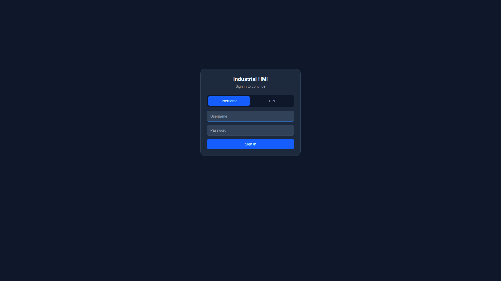
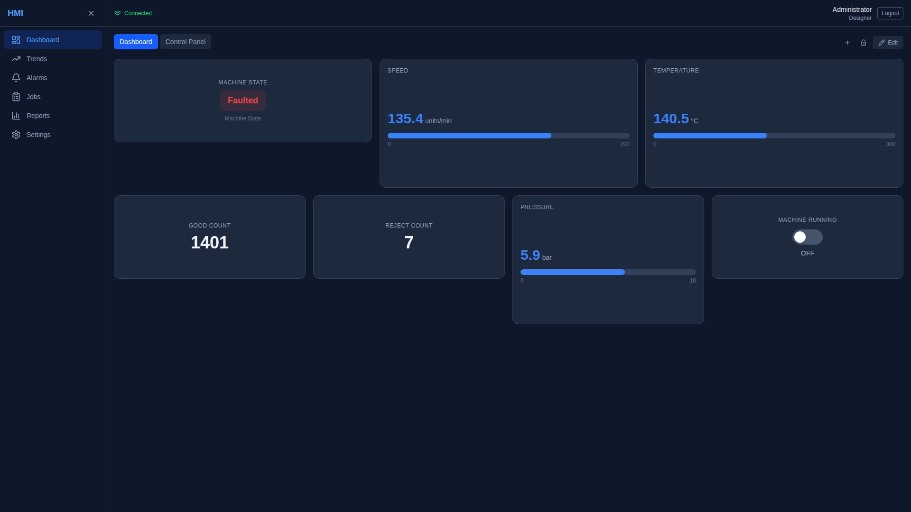
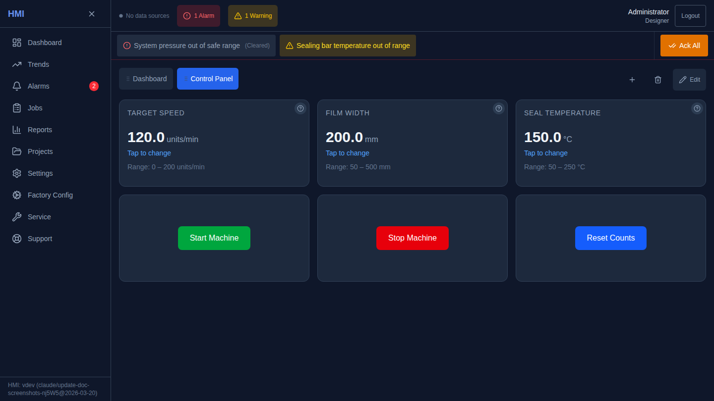
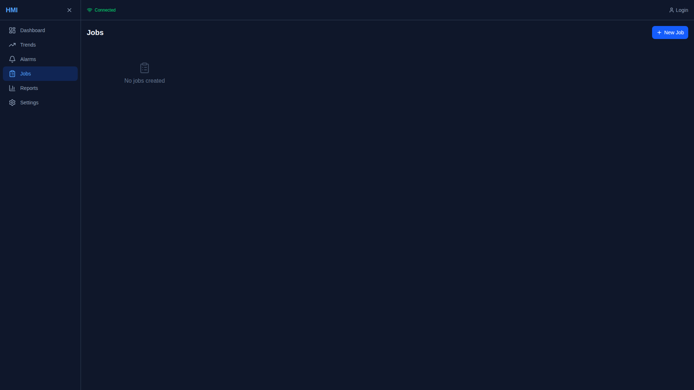
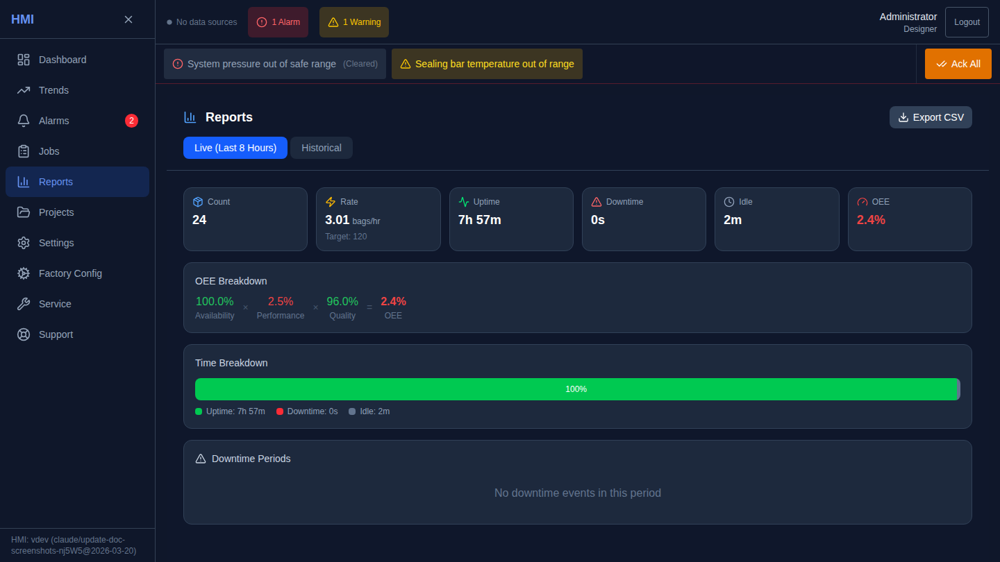

# Industrial HMI

A web-based Human-Machine Interface (HMI) for industrial automation. Connects to PLCs via OPC UA, Modbus TCP, EtherNet/IP, and MQTT, and provides real-time dashboards, alarming, trending, job management, and a built-in screen designer.

## Screenshots

| Login | Dashboard (Live Data) | Control Panel |
|:-----:|:---------------------:|:-------------:|
|  |  |  |

| Alarms | Trends | Jobs |
|:------:|:------:|:----:|
|  |  |  |

| Reports | Settings — Tags | Settings — Users |
|:-------:|:---------------:|:----------------:|
|  |  |  |

| Settings — Audit Trail |
|:-----------------------:|
|  |

## Features

- Real-time value display via WebSocket (500 ms update cycle)
- Drag-and-drop screen designer with widget palette, property panel, undo/redo, copy/paste, z-order, and grid snapping
- Two layout modes: responsive 12-column grid and pixel-perfect absolute positioning (for panel PCs)
- Widget types: status indicators, gauges, counters, toggles, command buttons, parameter inputs, text labels, OEE display, alarm summary, multi-value groups, dropdown selects, trend charts, ZPL label previews
- Per-widget font/style customization (font family, size, weight, color, italic)
- Per-widget visibility and enabled conditions (tag-based, role-based, or combined)
- Alarm management with boolean triggers, acknowledgment, filtering, sorting, and history
- Fault help dialog — auto-popup with images/animated GIFs and troubleshooting steps when alarms trigger
- Trend charting with configurable time ranges, saved views, and CSV export
- Job/recipe management with setpoint editing, download guards, version history, and upload-from-machine
- Production reporting with tag-driven OEE, time-series analytics, downtime Pareto, managed reason codes, and automatic shift scheduling
- Python scripting engine for button actions
- Multi-format tag import (HMI CSV, CODESYS XML, RSLogix 500 CSV) with preview and conflict resolution
- Data source management with connection testing and tag browsing
- Role-based access control (Operator, Supervisor, Engineer, Designer)
- Auto-logout on inactivity (30 minutes)
- Audit trail for all configuration changes with search and export
- Internal nonvolatile tags with persistent values that survive restarts (no PLC required)
- Service page for manual I/O monitoring and equipment actuation (momentary, toggle, numeric modes)
- Offline ZPL label preview with standalone page and designer widget (Pillow-based rendering)
- Multi-protocol PLC drivers (OPC UA, Modbus, EtherNet/IP, MQTT, simulation)
- CSV export on all data pages (alarms, trends, reports, audit)
- Screen versioning with automatic snapshots on every save

## Prerequisites

| Tool | Minimum | Windows | macOS | Linux |
|------|---------|---------|-------|-------|
| **Python** | 3.10+ | `winget install Python.Python.3.12` | `brew install python@3.12` | `sudo apt install python3 python3-pip` |
| **Node.js** | 18+ LTS | `winget install OpenJS.NodeJS.LTS` | `brew install node@22` | [nodejs.org](https://nodejs.org/) |

`pip` and `npm` come bundled with Python and Node.js respectively. No C compiler or native build tools are needed — all Python dependencies ship prebuilt wheels.

> **Offline install:** The `install` command automatically detects a `backend/wheels/` directory and installs Python dependencies from local wheel files without requiring internet access. To pre-download wheels on a machine with internet, run:
> ```bash
> pip download -r backend/requirements.txt -d backend/wheels
> ```
> Then copy the project (including `backend/wheels/`) to the offline machine and run `install` as usual.

Run the `doctor` command to verify your environment:

```bash
./dev.sh doctor        # Linux / macOS
dev.bat doctor         # Windows CMD
.\dev.ps1 doctor       # Windows PowerShell
```

> **Windows note:** If PowerShell blocks script execution, run `Set-ExecutionPolicy -Scope CurrentUser RemoteSigned` first.

## Quick Start

### Linux / macOS

```bash
git clone <repo-url>
cd universal-hmi
./dev.sh install       # Install pip + npm dependencies
./dev.sh seed          # Create database with demo users/tags/screens
./dev.sh dev           # Start backend (:8080) + frontend (:5173)
```

### Windows (CMD)

```cmd
git clone <repo-url>
cd universal-hmi
dev.bat install
dev.bat seed
dev.bat dev
```

### Windows (PowerShell)

```powershell
git clone <repo-url>
cd universal-hmi
.\dev.ps1 install
.\dev.ps1 seed
.\dev.ps1 dev
```

Then open [http://localhost:5173](http://localhost:5173) in your browser and log in with one of the default users below.

## Default Users

Created by `seed`:

| Username | Credential | Login mode | Role |
|----------|------------|------------|------|
| admin | admin | Password | Designer |
| engineer | engineer | Password | Engineer |
| supervisor | 1234 | PIN | Supervisor |
| operator | 0000 | PIN | Operator |

## Dev Script Commands

All platforms have the same commands — just use the script that matches your shell:

| Command | Description |
|---------|-------------|
| `install` | Install all dependencies (pip + npm; offline if `backend/wheels/` exists) |
| `dev` | Start backend (:8080) and frontend (:5173) dev servers (auto-kills existing processes) |
| `stop` | Stop any running dev servers on ports 8080 and 5173 |
| `build` | TypeScript check + Vite production build |
| `lint` | Run ESLint on the frontend |
| `check` | Run both build and lint |
| `test` | Run all tests (backend + frontend) |
| `test:backend` | Run backend tests only (pytest) |
| `test:frontend` | Run frontend tests only (Vitest) |
| `seed` | Seed database with default users, tags, and screens |
| `doctor` | Check prerequisites and project state |

```bash
./dev.sh <command>       # Linux / macOS
dev.bat <command>        # Windows CMD
.\dev.ps1 <command>      # Windows PowerShell
```

### Running Tests

The project has 252 automated tests covering backend services, API endpoints, frontend hooks, and widgets. See `DEVELOPER.md` → [Testing](#testing) for full details on test architecture and writing new tests.

```bash
# Run everything
./dev.sh test

# Backend only (172 tests — pytest)
./dev.sh test:backend

# Frontend only (80 tests — Vitest)
./dev.sh test:frontend

# Backend with coverage
cd backend && python -m pytest --cov=app tests/

# Single test file
cd backend && python -m pytest tests/unit/test_alarm_state_machine.py -v
cd frontend && npx vitest run src/hooks/__tests__/useDesignMode.test.ts
```

**Test dependencies:** Backend tests require `pip install -r backend/requirements-dev.txt`. Frontend test deps are included in `npm install`.

### Running Frontend or Backend Independently

```bash
# Frontend only (any OS)
cd frontend
npm run dev              # Vite dev server on :5173
npm run build            # tsc -b && vite build
npm run lint             # eslint .
npx tsc --noEmit         # Type check only

# Backend only (any OS)
cd backend
python run.py            # Start on :8080
python -m app.seed       # Seed database
```

---

## Documentation

- **[User Guide](docs/user-guide.md)** — Login, navigation, screen designer, data sources, tags, alarms, trends, jobs, reports, projects, factory config, service page, integrations, settings, and user management
- **[Deployment Guide](docs/deployment.md)** — Packaging, installing on Linux/Windows panel PCs, updating, rollback, and production configuration
- **[Developer Guide](DEVELOPER.md)** — Architecture deep-dive, adding widgets, creating plugin integrations, and code conventions

## Architecture

- **Backend** — Python / FastAPI with async SQLite (aiosqlite + SQLAlchemy). Handles PLC communication, tag engine, alarm service, trend logging, scripting, and a WebSocket endpoint for real-time tag updates.
- **Frontend** — React 19 + TypeScript + Tailwind CSS 4, built with Vite. Single-page app with live-updating widgets, a screen designer, and role-based access.

## Configuration

The backend is configured via environment variables (prefixed with `HMI_`) or a `.env` file in the backend directory:

| Variable | Default | Description |
|----------|---------|-------------|
| `HMI_DATABASE_URL` | `sqlite+aiosqlite:///./hmi.db` | Database connection string |
| `HMI_SECRET_KEY` | `change-me-in-production` | JWT signing key |
| `HMI_ACCESS_TOKEN_EXPIRE_MINUTES` | `480` | Token expiry (8 hours) |
| `HMI_WS_UPDATE_INTERVAL_MS` | `500` | WebSocket push interval |
| `HMI_HOST` | `0.0.0.0` | Server bind address |
| `HMI_PORT` | `8080` | Server port |
| `HMI_DEBUG` | `false` | Enable debug logging & reload |
| `HMI_TREND_RETENTION_DAYS` | `90` | Trend data retention |
| `HMI_SCRIPT_TIMEOUT_SECONDS` | `5` | Script execution timeout |

## Building for Production

```bash
./dev.sh build           # or: dev.bat build / .\dev.ps1 build
```

The built files go to `frontend/dist/`. The FastAPI backend can serve them directly as static files, or you can use a reverse proxy (nginx, Caddy, etc.).

For production deployments, make sure to:
1. Set `HMI_SECRET_KEY` to a strong, unique value.
2. Set `HMI_DEBUG` to `false`.
3. Use a persistent database (PostgreSQL recommended for multi-user production).
4. Place behind a reverse proxy with HTTPS.

For panel PC deployment (offline installation, systemd/NSSM services, compiled mode), see the [Deployment Guide](docs/deployment.md).

## Project Structure

```
universal-hmi/
├── dev.sh / dev.bat / dev.ps1   # Cross-platform dev scripts
├── backend/
│   ├── app/
│   │   ├── api/           # FastAPI route handlers
│   │   ├── core/          # Config, database, security
│   │   ├── drivers/       # PLC protocol drivers (opcua, modbus, ethernet_ip, mqtt) + driver_manager
│   │   ├── models/        # SQLAlchemy models
│   │   ├── integrations/  # Plugin integrations (zebra_printer, cognex_dataman, ftp_hot_folder)
│   │   ├── services/      # Tag engine, alarm service, trend service, script engine, ZPL renderer
│   │   ├── main.py        # FastAPI app entry point
│   │   └── seed.py        # Database seed script
│   ├── requirements.txt
│   └── run.py             # Dev server entry point
├── frontend/
│   ├── src/
│   │   ├── components/
│   │   │   ├── designer/  # Screen editor UI (palette, canvas, toolbar, property panel)
│   │   │   ├── layout/    # App shell, navigation
│   │   │   ├── reports/   # Production report components and charts
│   │   │   └── widgets/   # Runtime widget components
│   │   ├── hooks/         # useAuth, useWebSocket, useDesignMode
│   │   ├── lib/           # API client, utilities
│   │   ├── pages/         # Route-level page components
│   │   └── types/         # TypeScript interfaces
│   ├── package.json
│   └── vite.config.ts
├── docs/
│   ├── user-guide.md     # End-user documentation
│   └── deployment.md     # Panel PC deployment guide
├── screenshots/           # Application screenshots
├── REQUIREMENTS.md        # Functional & non-functional requirements
└── CLAUDE.md              # Developer reference
```

## License

See [LICENSE](LICENSE) for details.
