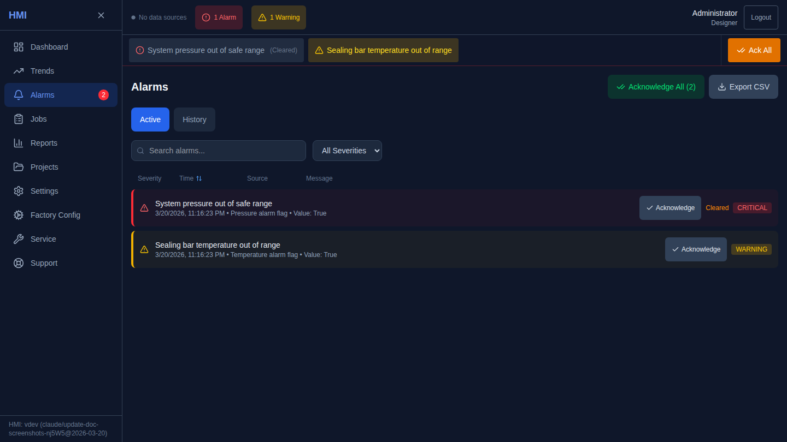
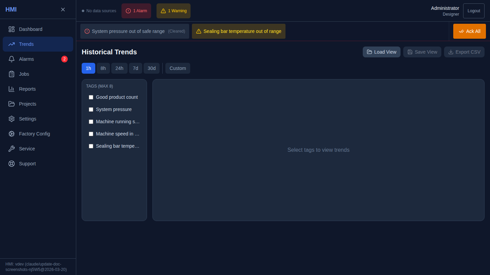

# Industrial HMI

A web-based Human-Machine Interface (HMI) for industrial automation. Connects to PLCs via OPC UA, Modbus TCP, EtherNet/IP, and MQTT, and provides real-time dashboards, alarming, trending, job management, and a built-in screen designer.

## Screenshots

| Login | Dashboard (Live Data) | Control Panel |
|:-----:|:---------------------:|:-------------:|
|  |  |  |

| Alarms | Trends | Jobs |
|:------:|:------:|:----:|
|  |  |  |

| Reports | Settings — Tags | Settings — Users |
|:-------:|:---------------:|:----------------:|
|  |  |  |

| Settings — Audit Trail |
|:-----------------------:|
|  |

## Features

- Real-time value display via WebSocket (500 ms update cycle)
- Drag-and-drop screen designer with widget palette, property panel, undo/redo, copy/paste, z-order, and grid snapping
- Two layout modes: responsive 12-column grid and pixel-perfect absolute positioning (for panel PCs)
- Widget types: status indicators, gauges, counters, toggles, command buttons, parameter inputs, text labels, OEE display, alarm summary, multi-value groups, dropdown selects
- Per-widget font/style customization (font family, size, weight, color, italic)
- Per-widget visibility and enabled conditions (tag-based, role-based, or combined)
- Alarm management with boolean triggers, acknowledgment, filtering, sorting, and history
- Trend charting with configurable time ranges, saved views, and CSV export
- Job/recipe management with setpoint editing, download guards, version history, and upload-from-machine
- OEE/production reporting with summary cards and charts
- Python scripting engine for button actions
- Multi-format tag import (HMI CSV, CODESYS XML, RSLogix 500 CSV) with preview and conflict resolution
- Data source management with connection testing and tag browsing
- Role-based access control (Operator, Supervisor, Engineer, Designer)
- Auto-logout on inactivity (30 minutes)
- Audit trail for all configuration changes with search and export
- Multi-protocol PLC drivers (OPC UA, Modbus, EtherNet/IP, MQTT, simulation)
- CSV export on all data pages (alarms, trends, reports, audit)
- Screen versioning with automatic snapshots on every save

## Prerequisites

| Tool | Minimum | Windows | macOS | Linux |
|------|---------|---------|-------|-------|
| **Python** | 3.10+ | `winget install Python.Python.3.12` | `brew install python@3.12` | `sudo apt install python3 python3-pip` |
| **Node.js** | 18+ LTS | `winget install OpenJS.NodeJS.LTS` | `brew install node@22` | [nodejs.org](https://nodejs.org/) |

`pip` and `npm` come bundled with Python and Node.js respectively. No C compiler or native build tools are needed — all Python dependencies ship prebuilt wheels.

Run the `doctor` command to verify your environment:

```bash
./dev.sh doctor        # Linux / macOS
dev.bat doctor         # Windows CMD
.\dev.ps1 doctor       # Windows PowerShell
```

> **Windows note:** If PowerShell blocks script execution, run `Set-ExecutionPolicy -Scope CurrentUser RemoteSigned` first.

## Quick Start

### Linux / macOS

```bash
git clone <repo-url>
cd universal-hmi
./dev.sh install       # Install pip + npm dependencies
./dev.sh seed          # Create database with demo users/tags/screens
./dev.sh dev           # Start backend (:8080) + frontend (:5173)
```

### Windows (CMD)

```cmd
git clone <repo-url>
cd universal-hmi
dev.bat install
dev.bat seed
dev.bat dev
```

### Windows (PowerShell)

```powershell
git clone <repo-url>
cd universal-hmi
.\dev.ps1 install
.\dev.ps1 seed
.\dev.ps1 dev
```

Then open [http://localhost:5173](http://localhost:5173) in your browser and log in with one of the default users below.

## Default Users

Created by `seed`:

| Username | Credential | Login mode | Role |
|----------|------------|------------|------|
| admin | admin | Password | Designer |
| engineer | engineer | Password | Engineer |
| supervisor | 1234 | PIN | Supervisor |
| operator | 0000 | PIN | Operator |

## Dev Script Commands

All platforms have the same commands — just use the script that matches your shell:

| Command | Description |
|---------|-------------|
| `install` | Install all dependencies (pip + npm) |
| `dev` | Start backend (:8080) and frontend (:5173) dev servers |
| `build` | TypeScript check + Vite production build |
| `lint` | Run ESLint on the frontend |
| `check` | Run both build and lint |
| `seed` | Seed database with default users, tags, and screens |
| `doctor` | Check prerequisites and project state |

```bash
./dev.sh <command>       # Linux / macOS
dev.bat <command>        # Windows CMD
.\dev.ps1 <command>      # Windows PowerShell
```

### Running Frontend or Backend Independently

```bash
# Frontend only (any OS)
cd frontend
npm run dev              # Vite dev server on :5173
npm run build            # tsc -b && vite build
npm run lint             # eslint .
npx tsc --noEmit         # Type check only

# Backend only (any OS)
cd backend
python run.py            # Start on :8080
python -m app.seed       # Seed database
```

---

## User Guide

### Logging In

The HMI supports two login modes:

1. **Username / Password** — For engineers and designers. Enter your username and password, then click **Sign In**.
2. **PIN** — For operators and supervisors. Switch to the **PIN** tab, enter your 4-digit PIN on the numeric keypad, and click **Sign In**.

After login, the header shows your name, role, and a **Logout** button. Sessions expire after 8 hours (configurable) or 30 minutes of inactivity.

### Navigating the Application

The sidebar provides access to all pages:

| Page | Purpose | Minimum Role |
|------|---------|--------------|
| **Dashboard** | Live process screens with real-time widgets | Operator |
| **Trends** | Historical data charting | Operator |
| **Alarms** | Active alarms and alarm history | Operator |
| **Jobs** | Recipe/job management and download | Supervisor |
| **Reports** | OEE and production reports | Operator |
| **Settings** | Tags, data sources, users, audit trail | Engineer |

The **Connected** indicator in the header shows real-time WebSocket status. Green means live data is flowing.

---

### Creating and Editing Screens

Screens are the main way to visualize and interact with your process. Only users with the **Designer** role can create and edit screens.

#### Creating a New Screen

1. Navigate to the **Dashboard** page.
2. Click the **+** button in the top-right corner of the screen tab bar.
3. Enter a **screen name** (e.g., "Motor Overview"). A URL-friendly slug is generated automatically.
4. Choose a **layout mode**:
   - **Grid** — Responsive 12-column layout that adapts to browser width. Best for desktop dashboards.
   - **Absolute** — Pixel-perfect fixed layout with a target resolution (e.g., 1920x1080). Best for dedicated panel PCs and touchscreens.
5. Click **Create**. The new screen appears as a tab and you can start editing immediately.

#### Entering Design Mode

- Press **Ctrl+E** or click the **Edit** button (pencil icon) in the screen tab bar.
- The screen designer activates with three panels:
  - **Widget Palette** (left) — Available widget types organized by category.
  - **Canvas** (center) — Your screen layout. Drag to move widgets, drag corners/edges to resize.
  - **Property Panel** (right) — Configure the selected widget's tag binding, appearance, and behavior.
  - **Toolbar** (top) — Undo/redo, save, grid controls, zoom.

#### Adding Widgets

1. In design mode, click a widget type in the **Widget Palette** on the left.
2. The widget appears on the canvas and is immediately selected.
3. Use the **Property Panel** on the right to:
   - **Bind a tag** — Click the tag picker dropdown and search for a tag name. The widget will display that tag's live value.
   - **Set titles, units, and ranges** — Configure display text, engineering units, min/max values.
   - **Set colors and thresholds** — Define normal, warning, and critical color ranges.
   - **Configure visibility** — Control when the widget appears based on tag values and/or user roles.
   - **Configure enabled state** — Control when the widget is interactive.

#### Available Widget Types

| Category | Widget | Description |
|----------|--------|-------------|
| **Display** | Status Indicator | Shows a tag's current state with color-coded labels (e.g., Running/Stopped/Faulted) |
| **Display** | Gauge | Horizontal bar gauge with min/max range and engineering units |
| **Display** | Counter | Large numeric display for counts (good parts, rejects, etc.) |
| **Display** | Text Value | Displays a tag's value with units and optional "Change value" link |
| **Display** | Alarm Summary | Embedded list of active alarms |
| **Display** | Multi-Value | Groups multiple tag values in a single card |
| **Display** | OEE | Overall Equipment Effectiveness display with availability, performance, quality |
| **Input** | Toggle | ON/OFF switch bound to a boolean tag |
| **Input** | Command Button | Executes a Python script action (e.g., start/stop machine, reset counters) |
| **Input** | Parameter Input | Numeric or text input with validation and range limits |
| **Input** | Dropdown Select | Select from predefined values to write to a tag |
| **Layout** | Container | Groups child widgets for organization |

#### Moving, Resizing, and Arranging Widgets

- **Move**: Click and drag a widget to reposition it. Snap-to-grid keeps things aligned.
- **Resize**: Drag a corner or edge handle to resize.
- **Multi-select**: Click empty canvas space and drag a marquee, or hold **Shift** and click multiple widgets.
- **Align**: Select multiple widgets, right-click, and choose alignment options (left, right, top, bottom, center).
- **Distribute**: Select 3+ widgets and distribute spacing evenly (horizontal or vertical).
- **Z-Order**: Use **Ctrl+]** / **Ctrl+[** to bring forward or send backward. **Ctrl+Shift+]** / **Ctrl+Shift+[** for front/back.
- **Lock**: Lock a widget to prevent accidental moves or deletes. Locked widgets show a lock icon.

#### Saving Screens

- Press **Ctrl+S** or click **Save** in the toolbar. A yellow dot on the screen name indicates unsaved changes.
- Click **Save & Exit** to save and return to runtime mode.
- Every save automatically creates a **version snapshot** for rollback. View version history via the API.
- To discard changes, press **Ctrl+E** or **Escape** while in design mode and confirm.

#### Deleting a Screen

1. Select the screen tab you want to delete.
2. Click the **trash** icon in the screen tab bar.
3. Confirm the deletion.

#### Keyboard Shortcuts (Design Mode)

| Shortcut | Action |
|----------|--------|
| `Ctrl+E` | Toggle design mode |
| `Ctrl+S` | Save |
| `Ctrl+Z` | Undo |
| `Ctrl+Shift+Z` | Redo |
| `Ctrl+C` / `Ctrl+X` / `Ctrl+V` | Copy / Cut / Paste |
| `Ctrl+D` | Duplicate selected |
| `Ctrl+A` | Select all |
| `Ctrl+]` / `Ctrl+[` | Bring forward / Send backward |
| `Ctrl+Shift+]` / `Ctrl+Shift+[` | Bring to front / Send to back |
| `Delete` | Delete selected (with confirmation) |
| `Shift+Delete` | Delete selected (skip confirmation) |
| `Escape` | Clear selection |

---

### Connecting to a PLC (Data Sources)

Data sources define how the HMI communicates with your PLCs and controllers. Requires the **Engineer** or **Designer** role.

#### Adding a Data Source

1. Go to **Settings** > **Data Sources** tab.
2. Click **+ Add Data Source**.
3. Fill in the configuration:
   - **Name** — A descriptive label (e.g., "Packaging Line PLC").
   - **Protocol** — Choose from:
     - **OPC-UA** — Endpoint URL (e.g., `opc.tcp://192.168.1.10:4840`), optional security policy and credentials.
     - **Modbus TCP** — Host IP, port (default 502), unit ID.
     - **EtherNet/IP** — Host IP, slot number.
     - **MQTT** — Broker address, port, optional credentials, topic prefix.
     - **Simulation** — No configuration needed; generates demo values.
4. Click **Save**.

#### Testing the Connection

1. After saving, click **Test Connection** on the data source row.
2. The system attempts to connect and reports success or failure.
3. For OPC-UA, the connection also auto-detects the CODESYS address prefix for tag import.

#### Browsing Tags from a PLC

1. Click **Browse** on a connected data source.
2. The system queries the PLC for available tags/nodes.
3. Select which tags to import (see [Importing Tags](#importing-tags) below).

---

### Importing Tags

Tags represent data points in your system — sensor readings, setpoints, machine states, counters, etc. The HMI supports three import formats.

#### Method 1: HMI CSV Import

Best for manually maintained tag lists or exporting/importing between HMI instances.

1. Go to **Settings** > **Tags** tab.
2. Click **Import Tags**.
3. Select the **HMI CSV** format.
4. Upload a CSV file with these columns:

   ```
   name,description,data_type,access_mode,engineering_units,min_value,max_value,address
   Machine.Speed,Line speed,float,read_write,units/min,0,200,
   Machine.Running,Motor running,bool,read_write,,,
   Machine.Temperature,Seal temp,float,read,°C,0,300,
   ```

5. Review the preview table. Check/uncheck individual tags.
6. Optionally assign a **data source**.
7. If tags already exist, choose a **conflict resolution** strategy:
   - **Skip conflicts** — Keep existing tags unchanged.
   - **Update conflicts** — Overwrite selected fields (display name, data type, address, etc.).
8. Click **Import**. A summary shows how many tags were imported, updated, or skipped.

#### Method 2: CODESYS XML Import

For importing tag structures directly from a CODESYS PLC project.

1. Click **Import Tags** and select **CODESYS XML**.
2. Upload the CODESYS symbol configuration XML file (exported from the CODESYS IDE).
3. The system parses the XML, expanding structs, function blocks, arrays, and enums into flat tag paths.
4. A grouped preview appears — tags are organized by their top-level program/struct.
5. Select/deselect entire groups or individual tags using checkboxes.
6. Optionally add a **tag name prefix** to namespace the imported tags.
7. Configure conflict resolution and click **Import**.

Enum types are automatically detected and their string mappings (e.g., `0: Stopped, 1: Running, 2: Faulted`) are preserved.

#### Method 3: RSLogix 500 CSV Import

For Allen-Bradley SLC 500 / MicroLogix PLCs.

1. Click **Import Tags** and select **RSLogix 500**.
2. Upload the RSLogix 500 database CSV export.
3. Tags are grouped by file type (Bits, Integers, Floats, Timers, Counters, Strings, etc.).
4. Select the tags you need, configure conflict resolution, and click **Import**.

#### Editing Tags After Import

- Click any tag row in the **Settings > Tags** table to edit its properties.
- Configure **display name**, **engineering units**, **data type**, and **address**.
- Enable **trending** to start recording historical data.
- Enable **alarms** and set severity, trigger condition, and message.
- Enable **simulation** for testing without a real PLC (sine, ramp, random, toggle, enum cycle).
- Use **bulk operations** to update, label, or delete multiple tags at once.

---

### Working with Alarms

#### Viewing Active Alarms

1. Navigate to the **Alarms** page.
2. The **Active** tab shows all current alarms (uncleared).
3. Filter by severity using the dropdown (Critical, Warning, Info).
4. Search by alarm message, tag name, or display name.
5. Sort by clicking column headers (Severity, Time, Source, Message).

#### Acknowledging Alarms

- Click the **Acknowledge** button on an individual alarm row.
- Or click **Acknowledge All** to acknowledge all unacknowledged alarms at once.
- Alarms transition through four states:
  1. **Active / Unacknowledged** — Alarm condition is true, not yet acknowledged.
  2. **Active / Acknowledged** — Alarm condition is true, operator has acknowledged.
  3. **Inactive / Unacknowledged** — Alarm cleared before being acknowledged.
  4. **Inactive** — Alarm cleared and acknowledged (moves to history).

#### Alarm History

- Switch to the **History** tab to view past alarms.
- History includes triggered time, acknowledged time/user, cleared time.
- Click **Export CSV** to download alarm records for reporting.

#### Configuring Alarms on Tags

1. Go to **Settings** > **Tags** and click on a tag.
2. Enable alarms and configure:
   - **Type**: Boolean (triggers when tag value matches `trigger_on`).
   - **Trigger On**: The value that activates the alarm (default: `true`).
   - **Severity**: Critical, Warning, or Info.
   - **Message**: Custom alarm text displayed to operators.

> **Note**: Analog threshold alarming (high/low limits) is handled on the PLC side and reported to the HMI as boolean fault flags.

---

### Viewing Trends

1. Navigate to the **Trends** page.
2. Select up to **8 tags** from the tag list on the left.
3. Choose a time range: **1h**, **8h**, **24h**, **7d**, **30d**, or **Custom** date range.
4. The chart updates with historical data for the selected tags.

#### Saving and Loading Trend Views

- Click **Save View** to save the current tag selection and time range as a named view.
- Click **Load View** to recall a previously saved view.
- Views persist across sessions, making it easy to return to frequently monitored tag sets.

#### Exporting Trend Data

- Click **Export CSV** to download the currently displayed trend data.
- The export includes timestamps, tag names, and values for the selected time range.

> **Tip**: Only tags with **trending enabled** in Settings > Tags will record historical data.

---

### Managing Jobs and Recipes

Jobs define sets of machine setpoints that can be downloaded to a PLC in one operation. Requires **Supervisor** role or higher.

#### Creating a Job

1. Navigate to the **Jobs** page.
2. Click **+ New Job**.
3. Enter a **name** and optional description.
4. Add **setpoints** — select writable tags and enter target values:
   - Tags are organized by label groups for easy navigation.
   - Use the search field to find specific tags.
   - Boolean tags show a toggle switch; numeric tags accept typed values.
5. Optionally add **download conditions** (guards):
   - Example: Machine must be in "idle" state and safety door must be "closed" before download.
   - Guards are checked before any setpoints are written.
6. Click **Save**.

#### Downloading a Job to the Machine

1. Open a job from the list.
2. Review the setpoints displayed in the detail view.
3. Click **Download**.
4. The system checks all download conditions:
   - If any guard fails, the download is rejected with a descriptive error.
   - If all guards pass, all setpoints are written atomically to the PLC.
5. The `$ACTIVE_JOB` system tag is updated with the job name.
6. The action is recorded in the audit trail.

#### Uploading Current Values as a New Job

- Click **Upload from Machine** to capture the current values of all writable tags and save them as a new job. This is useful for creating a baseline or saving a known-good configuration.

#### Job Version History

- Each time a job is edited and saved, a new version is created automatically.
- View the version history to see what changed and who made the change.

---

### Production Reports

1. Navigate to the **Reports** page.
2. View production run summaries in **Table** or **Charts** mode.
3. Reports include OEE metrics (Availability, Performance, Quality) and production counts.
4. Click **Export CSV** to download report data for external analysis.

---

### Managing Users

User management requires the **Supervisor** role or higher. Go to **Settings** > **Users**.

#### Adding a User

1. Click **+ Add User**.
2. Enter **username**, **display name**, and **password** (or PIN for operator/supervisor roles).
3. Select a **role**:
   - **Operator** — View dashboards, acknowledge alarms, view trends/reports.
   - **Supervisor** — All operator abilities + manage jobs, view users.
   - **Engineer** — All supervisor abilities + configure tags, data sources, alarms.
   - **Designer** — All engineer abilities + create and edit screens.
4. Click **Save**.

#### Editing or Disabling a User

- Click a user row to edit their display name, password, or role.
- Toggle the **Active** flag to disable a user without deleting them.
- Delete a user permanently from the edit dialog (requires Engineer role).

---

### Audit Trail

All configuration changes are logged with timestamps, usernames, actions, and source IPs.

1. Go to **Settings** > **Audit Trail** tab.
2. Browse logged actions: logins, tag changes, screen saves, user edits, job downloads, etc.
3. Filter by **action type** using the dropdown.
4. **Search** by keyword across all audit fields.
5. Click **Export CSV** to download the full audit log.

---

## Architecture

- **Backend** — Python / FastAPI with async SQLite (aiosqlite + SQLAlchemy). Handles PLC communication, tag engine, alarm service, trend logging, scripting, and a WebSocket endpoint for real-time tag updates.
- **Frontend** — React 19 + TypeScript + Tailwind CSS 4, built with Vite. Single-page app with live-updating widgets, a screen designer, and role-based access.

## Configuration

The backend is configured via environment variables (prefixed with `HMI_`) or a `.env` file in the backend directory:

| Variable | Default | Description |
|----------|---------|-------------|
| `HMI_DATABASE_URL` | `sqlite+aiosqlite:///./hmi.db` | Database connection string |
| `HMI_SECRET_KEY` | `change-me-in-production` | JWT signing key |
| `HMI_ACCESS_TOKEN_EXPIRE_MINUTES` | `480` | Token expiry (8 hours) |
| `HMI_WS_UPDATE_INTERVAL_MS` | `500` | WebSocket push interval |
| `HMI_HOST` | `0.0.0.0` | Server bind address |
| `HMI_PORT` | `8080` | Server port |
| `HMI_DEBUG` | `false` | Enable debug logging & reload |
| `HMI_TREND_RETENTION_DAYS` | `90` | Trend data retention |
| `HMI_SCRIPT_TIMEOUT_SECONDS` | `5` | Script execution timeout |

## Building for Production

```bash
./dev.sh build           # or: dev.bat build / .\dev.ps1 build
```

The built files go to `frontend/dist/`. The FastAPI backend can serve them directly as static files, or you can use a reverse proxy (nginx, Caddy, etc.).

For production deployments, make sure to:
1. Set `HMI_SECRET_KEY` to a strong, unique value.
2. Set `HMI_DEBUG` to `false`.
3. Use a persistent database (PostgreSQL recommended for multi-user production).
4. Place behind a reverse proxy with HTTPS.

---

## Deployment to Panel PCs

The project includes a `deploy.sh` script that packages the entire HMI — backend, frontend, and all Python dependencies — into a self-contained archive for offline installation on industrial panel PCs. No internet connection is required on the target machine.

### Prerequisites (Build Machine)

The packaging step runs on your **development machine** (Linux or macOS with internet access):

| Requirement | Purpose |
|-------------|---------|
| Python 3.10+ | Downloads pip wheels for the target |
| Node.js 18+ | Builds the frontend |
| `pip` | Downloads offline wheel packages |
| `zip` (optional) | Creates `.zip` archive for Windows targets |

### Prerequisites (Target Panel PC)

| Platform | Requirement |
|----------|-------------|
| **Linux** | Python 3.11+ installed (`sudo apt install python3 python3-venv`) |
| **Windows** | Python 3.11+ installed and on PATH ([python.org](https://www.python.org/downloads/)) |

No Node.js, npm, or internet connection is needed on the target — the frontend is pre-built and all Python packages are bundled as wheels.

### Step 1: Create the Deployment Package

On your development machine:

```bash
# Linux target only
./deploy.sh

# Linux + Windows targets
./deploy.sh --windows
```

This performs the following steps automatically:
1. Builds the frontend with `npm run build` (TypeScript check + Vite production build)
2. Copies the backend source and built frontend into a release directory
3. Downloads all Python dependency wheels for offline installation
4. Downloads Windows-specific wheels (when `--windows` is specified)
5. Generates platform-specific install scripts (`install.sh` and `install.bat`)
6. Creates deployment archives in `dist/`:
   - `dist/hmi-<timestamp>.tar.gz` — Linux deployment package (always created)
   - `dist/hmi-<timestamp>-windows.zip` — Windows deployment package (when `--windows` is used)

### Step 2: Deploy to the Target

#### Linux Panel PC

```bash
# 1. Copy the archive to the panel PC (USB drive, SCP, network share, etc.)
scp dist/hmi-*.tar.gz user@panel-pc:/tmp/

# 2. On the panel PC, extract the archive
tar -xzf /tmp/hmi-*.tar.gz

# 3. Run the installer (installs to /opt/hmi by default)
cd hmi-release
sudo ./install.sh

# Or specify a custom install location
sudo ./install.sh /home/hmi/app
```

The Linux installer:
- Verifies Python 3 is available
- Creates a Python virtual environment at the install location
- Installs all dependencies from bundled wheels (fully offline)
- Copies the application files and built frontend
- Creates a `.env` file with a generated `HMI_SECRET_KEY`
- Creates a **systemd service** (`hmi.service`) for auto-start on boot
- Seeds the database with default users and demo tags
- Creates convenience scripts (`start.sh`, `seed.sh`)

**After installation:**

```bash
# Start as a systemd service (auto-starts on boot)
sudo systemctl enable --now hmi

# Or start manually
/opt/hmi/start.sh

# Re-seed the database
/opt/hmi/seed.sh

# View logs
journalctl -u hmi -f

# Stop the service
sudo systemctl stop hmi
```

#### Windows Panel PC

1. Copy `dist/hmi-<timestamp>-windows.zip` to the panel PC (USB drive, network share, etc.)
2. Extract the archive (right-click > "Extract All" or use 7-Zip)
3. Open **Command Prompt as Administrator** in the `hmi-release` folder
4. Run the installer:

```cmd
install.bat

REM Or specify a custom install location
install.bat D:\hmi
```

The Windows installer:
- Verifies Python is available on PATH
- Creates a Python virtual environment at the install location (default: `C:\hmi`)
- Installs all dependencies from bundled wheels (fully offline, uses Windows-specific wheels when available)
- Copies the application files and built frontend
- Creates a `.env` file with a generated `HMI_SECRET_KEY`
- Configures a **Windows Firewall** rule to allow incoming connections on port 8080
- Seeds the database with default users and demo tags
- Creates convenience scripts (`start.bat`, `seed.bat`)

**After installation:**

```cmd
REM Start manually
C:\hmi\start.bat

REM Re-seed the database
C:\hmi\seed.bat
```

**Running as a Windows Service (recommended for production):**

The HMI should run as a service so it starts automatically on boot and survives user logoff. Use [NSSM](https://nssm.cc/) (Non-Sucking Service Manager):

```cmd
REM Install NSSM, then register the service:
nssm install HMI_Server "C:\hmi\venv\Scripts\python.exe" run.py
nssm set HMI_Server AppDirectory "C:\hmi"
nssm set HMI_Server AppEnvironmentExtra "PATH=C:\hmi\venv\Scripts;%PATH%"
nssm start HMI_Server

REM Or use Task Scheduler to run start.bat at logon
```

### Post-Deployment Verification

After installation on either platform, verify the deployment:

1. **Open a browser** on the panel PC and navigate to `http://localhost:8080`
2. **Log in** with the default credentials: username `admin`, password `admin`
3. **Check the WebSocket** — the "Connected" indicator in the header should show green
4. **Verify tag data** — navigate to the Dashboard and confirm simulated tag values are updating

If accessing from another machine on the network, use the panel PC's IP address (e.g., `http://192.168.1.100:8080`).

### Updating an Existing Installation

To deploy a new version to a panel PC that already has the HMI installed:

1. Build a new deployment package on your development machine (`./deploy.sh` or `./deploy.sh --windows`)
2. Stop the running service on the target:
   - Linux: `sudo systemctl stop hmi`
   - Windows: `nssm stop HMI_Server` or close the running `start.bat` window
3. Copy and extract the new archive to the target
4. Re-run the installer — it will overwrite application files but **preserve the existing `.env` and database**
5. Restart the service:
   - Linux: `sudo systemctl start hmi`
   - Windows: `nssm start HMI_Server` or run `start.bat`

### Production Configuration

For production panel PC deployments, review these settings in the `.env` file at the install location:

| Variable | Recommendation |
|----------|----------------|
| `HMI_SECRET_KEY` | Auto-generated during install — keep the generated value |
| `HMI_DEBUG` | Set to `false` (default) |
| `HMI_HOST` | `0.0.0.0` to accept connections from any network interface |
| `HMI_PORT` | `8080` (default) — change if needed, update firewall rules accordingly |
| `HMI_ACCESS_TOKEN_EXPIRE_MINUTES` | `480` (8 hours) — adjust to match shift length |
| `HMI_WS_UPDATE_INTERVAL_MS` | `500` — lower for faster updates, higher to reduce CPU usage |
| `HMI_TREND_RETENTION_DAYS` | `90` — increase for longer history, monitor disk usage |

### Deployment Directory Structure

After installation, the target machine will have:

```
/opt/hmi/                          # Linux (or C:\hmi on Windows)
├── venv/                          # Python virtual environment
├── app/                           # Backend application
│   ├── api/                       # Route handlers
│   ├── core/                      # Config, database, security
│   ├── drivers/                   # PLC protocol drivers
│   ├── models/                    # Database models
│   ├── services/                  # Business logic
│   ├── main.py                    # FastAPI entry point
│   └── seed.py                    # Database seeder
├── static/                        # Built frontend (served by FastAPI)
│   ├── assets/                    # JS, CSS bundles
│   └── index.html                 # SPA entry point
├── data/
│   └── hmi.db                     # SQLite database
├── run.py                         # Server entry point
├── requirements.txt               # Python dependencies list
├── .env                           # Environment configuration
├── start.sh (or start.bat)        # Manual start script
└── seed.sh (or seed.bat)          # Database seed script
```

## Project Structure

```
universal-hmi/
├── dev.sh / dev.bat / dev.ps1   # Cross-platform dev scripts
├── backend/
│   ├── app/
│   │   ├── api/           # FastAPI route handlers
│   │   ├── core/          # Config, database, security
│   │   ├── drivers/       # PLC protocol drivers (OPC-UA, Modbus, EtherNet/IP, MQTT)
│   │   ├── models/        # SQLAlchemy models
│   │   ├── services/      # Tag engine, alarm service, trend service, script engine
│   │   ├── main.py        # FastAPI app entry point
│   │   └── seed.py        # Database seed script
│   ├── requirements.txt
│   └── run.py             # Dev server entry point
├── frontend/
│   ├── src/
│   │   ├── components/
│   │   │   ├── designer/  # Screen editor UI (palette, canvas, toolbar, property panel)
│   │   │   ├── layout/    # App shell, navigation
│   │   │   └── widgets/   # Runtime widget components
│   │   ├── hooks/         # useAuth, useWebSocket, useDesignMode
│   │   ├── lib/           # API client, utilities
│   │   ├── pages/         # Route-level page components
│   │   └── types/         # TypeScript interfaces
│   ├── package.json
│   └── vite.config.ts
├── screenshots/           # Application screenshots
├── REQUIREMENTS.md        # Functional & non-functional requirements
└── CLAUDE.md              # Developer reference
```

## API Reference

### Authentication

| Method | Path | Description |
|--------|------|-------------|
| POST | `/api/auth/login` | Password login — returns JWT token |
| POST | `/api/auth/pin-login` | PIN login — returns JWT token |

### Tags

| Method | Path | Description |
|--------|------|-------------|
| GET | `/api/tags/` | List all tags |
| GET | `/api/tags/values` | Current tag values (snapshot) |
| POST | `/api/tags/values/{name}/write` | Write a value to a tag |
| POST | `/api/tags/import/csv` | Import tags from HMI CSV |
| POST | `/api/tags/import/codesys` | Import tags from CODESYS XML |
| POST | `/api/tags/import/codesys/preview` | Preview CODESYS import |
| POST | `/api/tags/import/rslogix500` | Import tags from RSLogix 500 CSV |
| POST | `/api/tags/import/rslogix500/preview` | Preview RSLogix 500 import |
| POST | `/api/tags/bulk/delete` | Bulk delete tags |
| POST | `/api/tags/bulk/update` | Bulk update tag fields |

### Screens

| Method | Path | Description |
|--------|------|-------------|
| GET | `/api/screens/` | List all screens |
| GET | `/api/screens/by-slug/{slug}` | Get screen by URL slug |
| POST | `/api/screens/` | Create a new screen |
| PUT | `/api/screens/{id}` | Update screen layout (auto-versions) |
| DELETE | `/api/screens/{id}` | Delete a screen |
| GET | `/api/screens/{id}/versions` | Screen version history |
| GET | `/api/screens/templates/list` | List screen templates |

### Alarms

| Method | Path | Description |
|--------|------|-------------|
| GET | `/api/alarms/active` | Active alarms |
| GET | `/api/alarms/history` | Alarm history (with pagination) |
| POST | `/api/alarms/{id}/acknowledge` | Acknowledge an alarm |

### Trends

| Method | Path | Description |
|--------|------|-------------|
| GET | `/api/trends/data/{tag_id}` | Historical trend data for a tag |

### Data Sources

| Method | Path | Description |
|--------|------|-------------|
| GET | `/api/datasources` | List data sources with connection status |
| POST | `/api/datasources` | Create a data source |
| PUT | `/api/datasources/{id}` | Update a data source |
| DELETE | `/api/datasources/{id}` | Delete a data source |
| POST | `/api/datasources/{id}/connect` | Test connection |
| POST | `/api/datasources/{id}/browse` | Browse available tags |

### Jobs

| Method | Path | Description |
|--------|------|-------------|
| GET | `/api/jobs/` | List all jobs |
| POST | `/api/jobs/` | Create a job |
| PUT | `/api/jobs/{id}` | Update a job (auto-versions) |
| DELETE | `/api/jobs/{id}` | Delete a job |
| POST | `/api/jobs/{id}/download` | Download job setpoints to machine |
| POST | `/api/jobs/upload-from-machine` | Capture current values as a new job |

### Users

| Method | Path | Description |
|--------|------|-------------|
| GET | `/api/users/` | List users |
| POST | `/api/users/` | Create a user |
| PUT | `/api/users/{id}` | Update a user |
| DELETE | `/api/users/{id}` | Delete a user |

### WebSocket

| Path | Description |
|------|-------------|
| `/ws` | Real-time tag values and alarm updates |

**Message types:** `snapshot` (initial state), `tag_update` (value deltas), `alarm` (state changes), `keepalive` (every 30s)

## License

See [LICENSE](LICENSE) for details.
