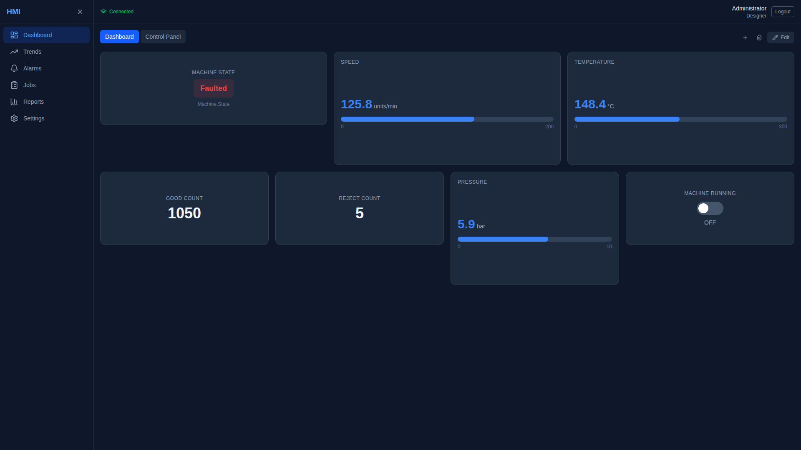
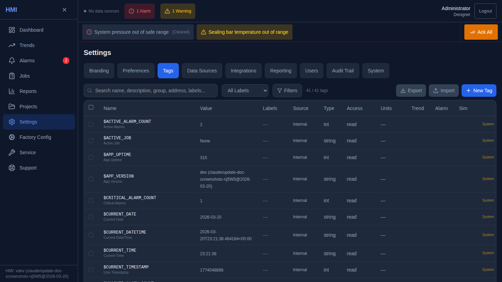

# Industrial HMI

A web-based Human-Machine Interface (HMI) for industrial automation. Connects to PLCs via OPC UA, Modbus TCP, EtherNet/IP, and MQTT, and provides real-time dashboards, alarming, trending, job management, and a built-in screen designer.

## Architecture

- **Backend** — Python / FastAPI with async SQLite (aiosqlite + SQLAlchemy). Handles PLC communication, tag engine, alarm service, trend logging, scripting, and a WebSocket endpoint for real-time tag updates.
- **Frontend** — React 19 + TypeScript + Tailwind CSS 4, built with Vite. Single-page app with live-updating widgets, a screen designer, and role-based access.

## Features

- Real-time value display via WebSocket (500 ms update cycle)
- Drag-and-drop screen designer with widget palette, property panel, undo/redo, copy/paste, z-order, and grid snapping
- Widget types: status indicators, gauges, counters, toggles, command buttons, parameter inputs, text labels, OEE display, alarm summary, multi-value groups, dropdown selects
- Per-widget font/style customization (font family, size, weight, color, italic)
- Per-widget visibility and enabled conditions (tag-based, role-based, or combined)
- Alarm management with boolean triggers, acknowledgment, filtering, sorting, and history
- Trend charting with configurable sample rates, retention, and saved views
- Job/recipe management with setpoint editing, cloning, and download
- OEE/production reporting with summary cards and charts
- Python scripting engine for button actions
- Role-based access control (Operator, Supervisor, Engineer, Designer)
- Auto-logout on inactivity (30 minutes)
- Audit trail for all configuration changes with search and export
- Multi-protocol PLC drivers (OPC UA, Modbus, EtherNet/IP, MQTT, simulation)
- CSV export on all data pages (alarms, trends, reports, audit)

## Screenshots

| Dashboard | Alarms | Settings |
|:---------:|:------:|:--------:|
|  |  |  |

| Trends | Jobs | Reports |
|:------:|:----:|:-------:|
|  |  |  |

## Prerequisites

| Tool | Minimum | Windows | macOS | Linux |
|------|---------|---------|-------|-------|
| **Python** | 3.10+ | `winget install Python.Python.3.12` | `brew install python@3.12` | `sudo apt install python3 python3-pip` |
| **Node.js** | 18+ LTS | `winget install OpenJS.NodeJS.LTS` | `brew install node@22` | [nodejs.org](https://nodejs.org/) |

`pip` and `npm` come bundled with Python and Node.js respectively. No C compiler or native build tools are needed — all Python dependencies ship prebuilt wheels.

Run the `doctor` command to verify your environment:

```bash
./dev.sh doctor        # Linux / macOS
dev.bat doctor         # Windows CMD
.\dev.ps1 doctor       # Windows PowerShell
```

> **Windows note:** If PowerShell blocks script execution, run `Set-ExecutionPolicy -Scope CurrentUser RemoteSigned` first.

## Quick Start

### Linux / macOS

```bash
git clone <repo-url>
cd opcua-hmi
./dev.sh install       # Install pip + npm dependencies
./dev.sh seed          # Create database with demo users/tags/screens
./dev.sh dev           # Start backend (:8080) + frontend (:5173)
```

### Windows (CMD)

```cmd
git clone <repo-url>
cd opcua-hmi
dev.bat install
dev.bat seed
dev.bat dev
```

### Windows (PowerShell)

```powershell
git clone <repo-url>
cd opcua-hmi
.\dev.ps1 install
.\dev.ps1 seed
.\dev.ps1 dev
```

Then open [http://localhost:5173](http://localhost:5173) in your browser.

## Dev Script Commands

All platforms have the same commands — just use the script that matches your shell:

| Command | Description |
|---------|-------------|
| `install` | Install all dependencies (pip + npm) |
| `dev` | Start backend (:8080) and frontend (:5173) dev servers |
| `build` | TypeScript check + Vite production build |
| `lint` | Run ESLint on the frontend |
| `check` | Run both build and lint |
| `seed` | Seed database with default users, tags, and screens |
| `doctor` | Check prerequisites and project state |

```bash
./dev.sh <command>       # Linux / macOS
dev.bat <command>        # Windows CMD
.\dev.ps1 <command>      # Windows PowerShell
```

The scripts check for Python and Node.js before running and show install instructions if anything is missing.

### Running Frontend or Backend Independently

```bash
# Frontend only (any OS)
cd frontend
npm run dev              # Vite dev server on :5173
npm run build            # tsc -b && vite build
npm run lint             # eslint .
npx tsc --noEmit         # Type check only

# Backend only (any OS)
cd backend
python run.py            # Start on :8080
python -m app.seed       # Seed database
```

## Default Users

Created by `seed`:

| Username | Credential | Login mode | Role |
|----------|------------|------------|------|
| admin | admin | Password | Designer |
| engineer | engineer | Password | Engineer |
| supervisor | 1234 | PIN | Supervisor |
| operator | 0000 | PIN | Operator |

## Building for Production

```bash
./dev.sh build           # or: dev.bat build / .\dev.ps1 build
```

The built files go to `frontend/dist/`. The FastAPI backend can serve them directly as static files, or you can use a reverse proxy (nginx, Caddy, etc.).

## Project Structure

```
opcua-hmi/
├── dev.sh / dev.bat / dev.ps1   # Cross-platform dev scripts
├── backend/
│   ├── app/
│   │   ├── api/           # FastAPI route handlers
│   │   ├── core/          # Config, database, security
│   │   ├── drivers/       # PLC protocol drivers
│   │   ├── models/        # SQLAlchemy models
│   │   ├── services/      # Tag engine, alarm service, trend service
│   │   ├── main.py        # FastAPI app entry point
│   │   └── seed.py        # Database seed script
│   ├── requirements.txt
│   └── run.py             # Dev server entry point
├── frontend/
│   ├── src/
│   │   ├── components/
│   │   │   ├── designer/  # Screen editor UI (palette, canvas, toolbar, property panel)
│   │   │   ├── layout/    # App shell, navigation
│   │   │   └── widgets/   # Runtime widget components
│   │   ├── hooks/         # useAuth, useWebSocket, useDesignMode
│   │   ├── lib/           # API client, utilities
│   │   ├── pages/         # Route-level page components
│   │   └── types/         # TypeScript interfaces
│   ├── package.json
│   └── vite.config.ts
├── screenshots/           # Auto-generated application screenshots
├── REQUIREMENTS.md        # Functional & non-functional requirements
└── CLAUDE.md              # Developer reference
```

## Configuration

The backend is configured via environment variables (prefixed with `HMI_`) or a `.env` file in the backend directory:

| Variable | Default | Description |
|----------|---------|-------------|
| `HMI_DATABASE_URL` | `sqlite+aiosqlite:///./hmi.db` | Database connection string |
| `HMI_SECRET_KEY` | `change-me-in-production` | JWT signing key |
| `HMI_ACCESS_TOKEN_EXPIRE_MINUTES` | `480` | Token expiry (8 hours) |
| `HMI_WS_UPDATE_INTERVAL_MS` | `500` | WebSocket push interval |
| `HMI_HOST` | `0.0.0.0` | Server bind address |
| `HMI_PORT` | `8080` | Server port |
| `HMI_DEBUG` | `false` | Enable debug logging & reload |
| `HMI_TREND_RETENTION_DAYS` | `90` | Trend data retention |
| `HMI_SCRIPT_TIMEOUT_SECONDS` | `5` | Script execution timeout |

## Screen Designer

Users with the **Designer** role can enter edit mode on any screen:

- **Ctrl+E** or click the Edit button to toggle design mode
- **Widget Palette** (left) — click to add widgets to the canvas
- **Canvas** (center) — drag to move, corner handle to resize, click to select
- **Property Panel** (right) — configure tag binding, thresholds, colors, font styles, visibility/enabled roles
- **Toolbar** (top) — undo/redo, save, grid settings, zoom
- **Keyboard shortcuts** — Ctrl+Z/Shift+Z (undo/redo), Ctrl+C/X/V/D (clipboard), Delete, Ctrl+]/[ (z-order)

Live PLC data continues flowing into widgets while editing.
