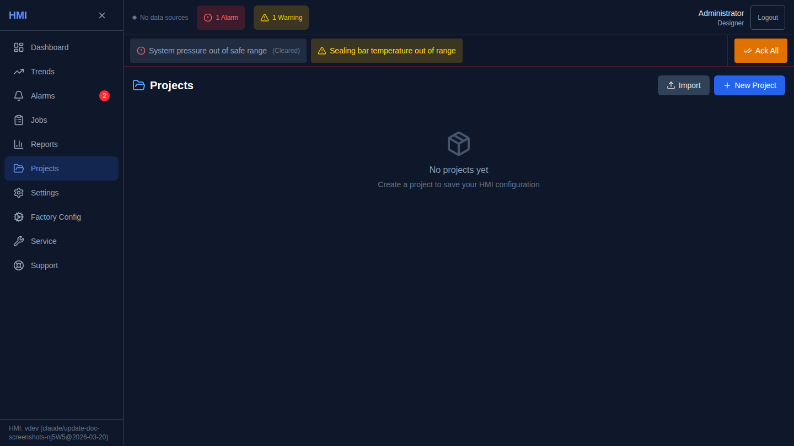
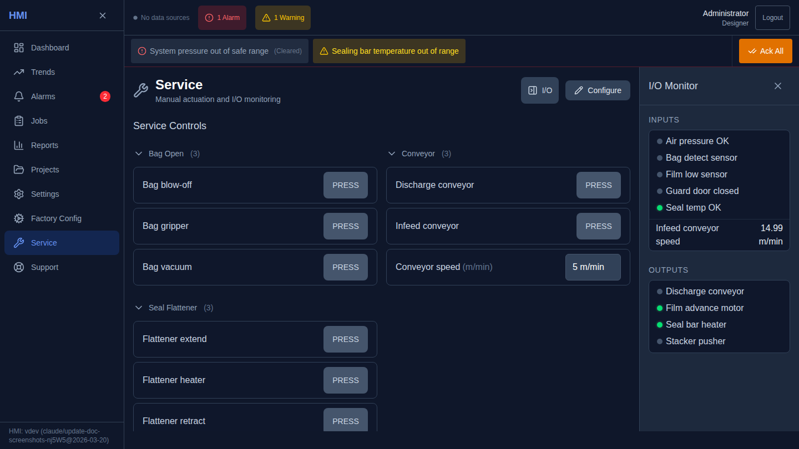
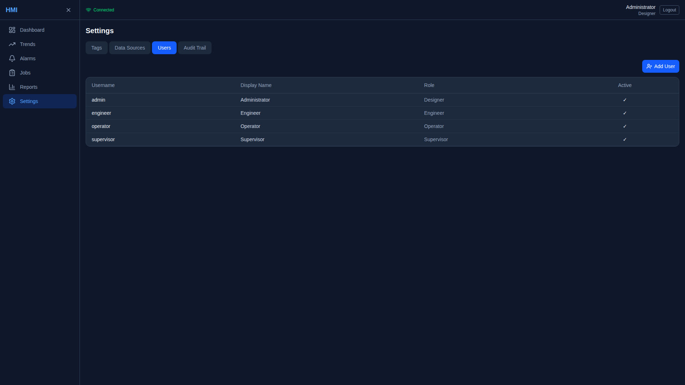
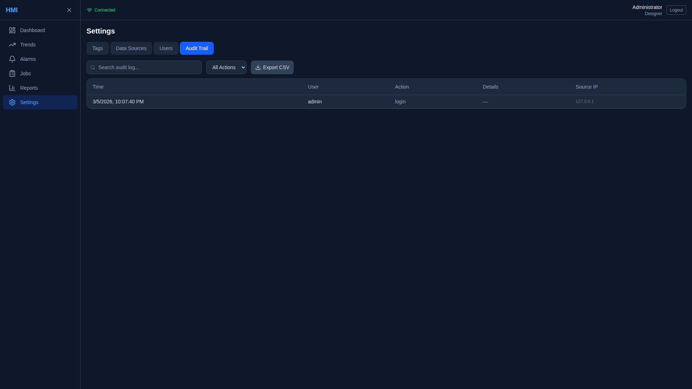
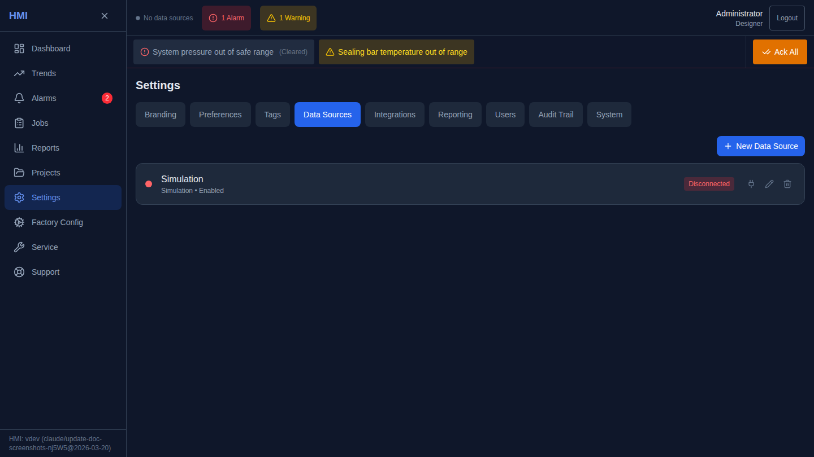
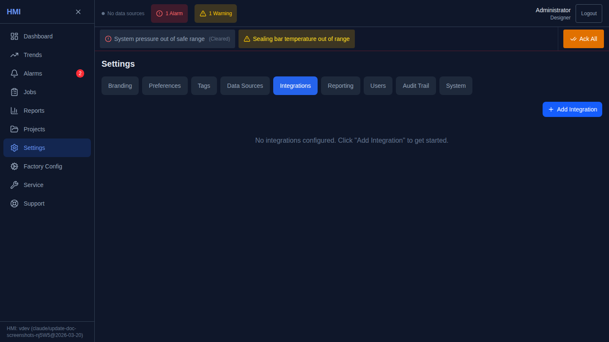
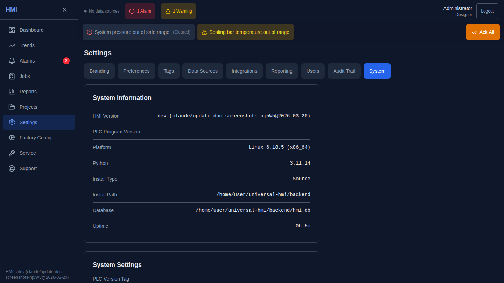
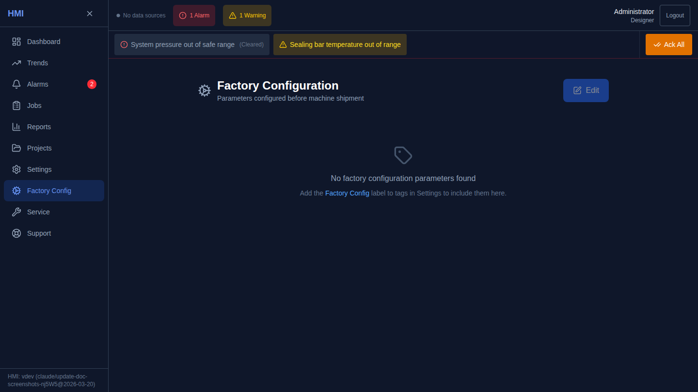
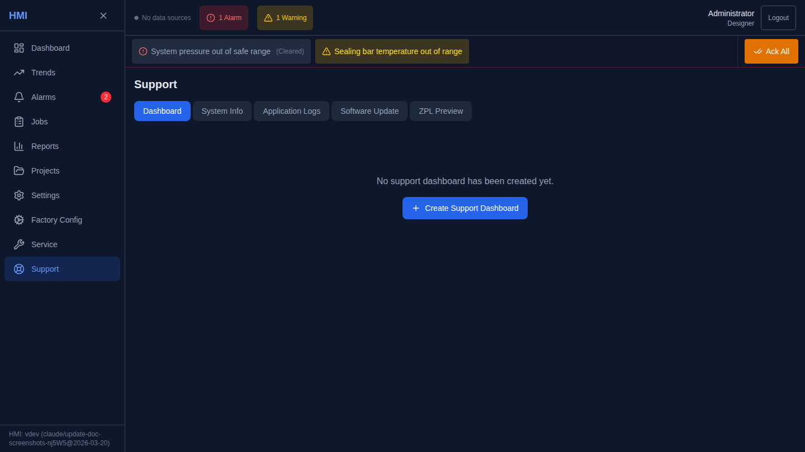

# Industrial HMI

A web-based Human-Machine Interface (HMI) for industrial automation. Connects to PLCs via OPC UA, Modbus TCP, EtherNet/IP, and MQTT, and provides real-time dashboards, alarming, trending, job/recipe management, and a built-in screen designer.

This HMI runs in a web browser — think of it like a Rockwell FactoryTalk or CODESYS WebVisu, but open-source and protocol-agnostic. It works with any PLC brand that supports one of the protocols above.

## Screenshots

| Login | Dashboard (Live Data) | Control Panel |
|:-----:|:---------------------:|:-------------:|
|  |  |  |

| Alarms | Trends | Jobs |
|:------:|:------:|:----:|
|  |  |  |

| Reports | Projects | Service |
|:-------:|:--------:|:-------:|
|  |  |  |

| Settings — Tags | Settings — Users | Settings — Audit Trail |
|:---------------:|:----------------:|:----------------------:|
|  |  |  |

| Settings — Data Sources | Settings — Integrations | Settings — System |
|:-----------------------:|:-----------------------:|:-----------------:|
|  |  |  |

| Factory Config | Support |
|:--------------:|:-------:|
|  |  |

## Features

- **Real-time value display** — tag values update in the browser every 500 ms via WebSocket (similar to how a traditional HMI polls a PLC, but push-based)
- **Drag-and-drop screen designer** — build screens visually with a widget palette, property panel, undo/redo, copy/paste, z-order, and grid snapping (like a Rockwell FTView or CODESYS screen editor, but in the browser)
- **Two layout modes** — responsive grid (adapts to screen size) and pixel-perfect absolute positioning (for dedicated panel PCs with fixed resolution)
- **Widget library** — status indicators, gauges, counters, toggles, command buttons, parameter inputs, text labels, OEE display, alarm summary, multi-value groups, dropdown selects, trend charts, ZPL label previews
- **Per-widget styling** — font family, size, weight, color, italic
- **Conditional visibility and enable** — show/hide or enable/disable widgets based on tag values and/or user roles (e.g., show a "Start" button only when the machine is idle, or only for Engineers)
- **Alarm management** — boolean fault triggers from the PLC, acknowledgment, filtering, sorting, and alarm history (analog thresholds are handled on the PLC side and reported as boolean fault flags)
- **Fault help dialog** — auto-popup with images/animated GIFs and troubleshooting steps when an alarm triggers (great for training and reducing call-outs)
- **Trend charting** — historical data with configurable time ranges, saved views, and CSV export
- **Job/recipe management** — setpoint editing, download guards, version history, and upload-from-machine
- **Production reporting** — tag-driven OEE, time-series analytics, downtime Pareto, managed reason codes, and automatic shift scheduling
- **Python scripting** — attach short scripts to command buttons for multi-tag writes, conditional logic, and simple automation
- **Tag import** — bulk import from HMI CSV, CODESYS XML, and RSLogix 500 CSV with preview and conflict resolution
- **Live OPC-UA tag browsing** — browse the PLC's address space and import tags directly (no manual address entry)
- **Data source management** — add PLC connections with built-in connection testing
- **Role-based access** — Operator, Supervisor, Engineer, Designer (similar to traditional HMI user levels)
- **Auto-logout** on inactivity (30 minutes, configurable to match shift length)
- **Audit trail** — logs all configuration changes, control actions, and logins with search and CSV export
- **Internal nonvolatile tags** — persistent values that survive restarts without needing a PLC (useful for operator-settable flags, counters, and HMI-only parameters)
- **Service page** — manual I/O monitoring and equipment actuation with momentary, toggle, and numeric modes (for commissioning and maintenance)
- **ZPL label preview** — offline Zebra label rendering without a printer
- **Multi-protocol PLC drivers** — OPC UA, Modbus TCP, EtherNet/IP, MQTT, and simulation
- **CSV export** on all data pages (alarms, trends, reports, audit)
- **Screen versioning** — automatic snapshots on every save with rollback capability
- **Runs fully offline** — no internet connection or cloud service required

## Prerequisites

You need two tools installed on your development machine. These are only needed for development — production deployments bundle everything (see the [Deployment Guide](docs/deployment.md)).

| Tool | What it is | Minimum | Windows | macOS | Linux |
|------|-----------|---------|---------|-------|-------|
| **Python** | Runs the backend server (PLC communication, tag engine, alarms, database) | 3.10+ | `winget install Python.Python.3.12` | `brew install python@3.12` | `sudo apt install python3 python3-pip` |
| **Node.js** | Builds the browser-based user interface | 18+ LTS | `winget install OpenJS.NodeJS.LTS` | `brew install node@22` | [nodejs.org](https://nodejs.org/) |

`pip` (Python's package manager) and `npm` (Node.js's package manager) come bundled automatically. No C compiler or special build tools are needed — all dependencies come prebuilt.

> **Offline install:** The `install` command automatically detects a `backend/wheels/` directory and installs Python dependencies from local wheel files without requiring internet access. To pre-download wheels on a machine with internet, run:
> ```bash
> pip download -r backend/requirements.txt -d backend/wheels
> ```
> Then copy the project (including `backend/wheels/`) to the offline machine and run `install` as usual.

Run the `doctor` command to verify your environment:

```bash
./dev.sh doctor        # Linux / macOS
dev.bat doctor         # Windows CMD
.\dev.ps1 doctor       # Windows PowerShell
```

> **Windows note:** If PowerShell blocks script execution, run `Set-ExecutionPolicy -Scope CurrentUser RemoteSigned` first.

## Quick Start

### Linux / macOS

```bash
git clone <repo-url>
cd universal-hmi
./dev.sh install       # Install pip + npm dependencies
./dev.sh seed          # Create database with demo users/tags/screens
./dev.sh dev           # Start backend (:8080) + frontend (:5173)
```

### Windows (CMD)

```cmd
git clone <repo-url>
cd universal-hmi
dev.bat install
dev.bat seed
dev.bat dev
```

### Windows (PowerShell)

```powershell
git clone <repo-url>
cd universal-hmi
.\dev.ps1 install
.\dev.ps1 seed
.\dev.ps1 dev
```

Then open [http://localhost:5173](http://localhost:5173) in your browser and log in with one of the default users below.

## Default Users

Created by `seed`:

| Username | Credential | Login mode | Role |
|----------|------------|------------|------|
| admin | admin | Password | Designer |
| engineer | engineer | Password | Engineer |
| supervisor | 1234 | PIN | Supervisor |
| operator | 0000 | PIN | Operator |

## Dev Script Commands

All platforms have the same commands — just use the script that matches your shell:

| Command | Description |
|---------|-------------|
| `install` | Download and install all software libraries the project depends on (offline-capable if `backend/wheels/` exists) |
| `dev` | Start both servers for development — the backend (port 8080) and the browser UI (port 5173) |
| `stop` | Stop any running dev servers |
| `build` | Compile the browser UI into production-ready files (checks for errors first) |
| `lint` | Check the frontend code for common mistakes and style issues |
| `check` | Run both `build` and `lint` together |
| `test` | Run all automated tests (backend + frontend) |
| `test:backend` | Run backend tests only |
| `test:frontend` | Run frontend tests only |
| `seed` | Populate the database with default users, demo tags, and sample screens |
| `doctor` | Verify that Python, Node.js, and other prerequisites are installed correctly |

```bash
./dev.sh <command>       # Linux / macOS
dev.bat <command>        # Windows CMD
.\dev.ps1 <command>      # Windows PowerShell
```

### Running Tests

The project has 252 automated tests that verify the alarm state machine, OEE calculations, tag simulation, authentication, and more. Think of these like a self-check that confirms everything still works correctly after a code change.

```bash
# Run everything
./dev.sh test

# Backend only (172 tests)
./dev.sh test:backend

# Frontend only (80 tests)
./dev.sh test:frontend

# Backend with a coverage report (shows which code paths are tested)
cd backend && python -m pytest --cov=app tests/

# Run a single test file (useful when debugging a specific area)
cd backend && python -m pytest tests/unit/test_alarm_state_machine.py -v
cd frontend && npx vitest run src/hooks/__tests__/useDesignMode.test.ts
```

**Test dependencies:** Backend tests require `pip install -r backend/requirements-dev.txt`. Frontend test dependencies are included in the normal `install` step.

### Running Frontend or Backend Independently

You can run just one half of the application if you're only working on one side:

```bash
# Browser UI only (any OS) — runs on port 5173
cd frontend
npm run dev              # Start the development server
npm run build            # Build for production
npm run lint             # Check code for issues

# Backend server only (any OS) — runs on port 8080
cd backend
python run.py            # Start the server (PLC comms, tag engine, API)
python -m app.seed       # Populate database with demo data
```

---

## Documentation

- **[User Guide](docs/user-guide.md)** — Login, navigation, screen designer, data sources, tags, alarms, trends, jobs, reports, projects, factory config, service page, integrations, settings, and user management
- **[Deployment Guide](docs/deployment.md)** — Packaging, installing on Linux/Windows panel PCs, updating, rollback, and production configuration
- **[Developer Guide](DEVELOPER.md)** — Architecture deep-dive, adding widgets, creating plugin integrations, and code conventions

## Architecture

The application has two halves, similar to how a traditional HMI has a runtime (what operators see) and an engineering environment (where you configure it):

- **Backend** (the `backend/` folder) — A Python server that handles PLC communication, the tag engine, alarm processing, trend logging, scripting, and pushing live data to browsers. Think of it as the "runtime" — it talks to your PLCs, evaluates alarms, and stores data. Built with FastAPI (a Python web framework) and SQLite (an embedded database, like a single-file version of SQL Server).
- **Frontend** (the `frontend/` folder) — The browser-based user interface that operators, supervisors, and engineers interact with. It displays live tag values, alarm lists, trends, reports, and includes the drag-and-drop screen designer. Built with React (a UI framework) and TypeScript (JavaScript with type checking).

## Configuration

The backend is configured via environment variables (prefixed with `HMI_`) or a `.env` text file in the `backend/` directory. Environment variables are name=value settings that control how the server behaves — similar to PLC system parameters.

| Variable | Default | Description |
|----------|---------|-------------|
| `HMI_DATABASE_URL` | `sqlite+aiosqlite:///./hmi.db` | Path to the database file (stores tags, screens, alarms, trends, users) |
| `HMI_SECRET_KEY` | `change-me-in-production` | Security key for login tokens — change this on production systems |
| `HMI_ACCESS_TOKEN_EXPIRE_MINUTES` | `480` | How long a login session lasts before requiring re-login (480 = 8 hours) |
| `HMI_WS_UPDATE_INTERVAL_MS` | `500` | How often live tag values are pushed to browsers (500 = twice per second) |
| `HMI_HOST` | `0.0.0.0` | Network address to listen on (`0.0.0.0` = accept connections from any network interface) |
| `HMI_PORT` | `8080` | TCP port the server listens on |
| `HMI_DEBUG` | `false` | Enable verbose logging and auto-reload on code changes (development only) |
| `HMI_TREND_RETENTION_DAYS` | `90` | How many days of trend history to keep before automatic cleanup |
| `HMI_SCRIPT_TIMEOUT_SECONDS` | `5` | Maximum execution time for button scripts before they are killed |

## Building for Production

```bash
./dev.sh build           # or: dev.bat build / .\dev.ps1 build
```

This compiles the browser UI into optimized files in `frontend/dist/`. The backend server can serve these directly — no separate web server is needed.

For production deployments, make sure to:
1. Set `HMI_SECRET_KEY` to a strong, unique value (the default is insecure).
2. Set `HMI_DEBUG` to `false`.
3. Consider using PostgreSQL instead of SQLite for multi-user production environments.
4. For internet-facing installations, place behind a reverse proxy with HTTPS.

For **panel PC deployment** (the most common use case — offline installation, auto-start on boot, compiled mode), see the [Deployment Guide](docs/deployment.md).

## Project Structure

```
universal-hmi/
├── dev.sh / dev.bat / dev.ps1   # Cross-platform helper scripts (like a Makefile)
├── backend/                     # SERVER — runs on the machine, talks to PLCs
│   ├── app/
│   │   ├── api/           # HTTP endpoints (what the browser calls to get/send data)
│   │   ├── core/          # Configuration, database setup, login/security
│   │   ├── drivers/       # PLC protocol drivers (OPC-UA, Modbus, EtherNet/IP, MQTT)
│   │   ├── models/        # Database table definitions (tags, screens, alarms, users, etc.)
│   │   ├── integrations/  # Plugin integrations (Zebra printer, Cognex DataMan, FTP hot folder)
│   │   ├── services/      # Core logic: tag engine, alarm service, trend service, script engine
│   │   ├── main.py        # Server startup — ties everything together
│   │   └── seed.py        # Populates the database with demo data
│   ├── requirements.txt   # List of Python libraries the backend needs
│   └── run.py             # Entry point to start the server
├── frontend/                    # BROWSER UI — what operators and engineers see
│   ├── src/
│   │   ├── components/
│   │   │   ├── designer/  # Screen editor (palette, canvas, toolbar, property panel)
│   │   │   ├── layout/    # Navigation sidebar and header bar
│   │   │   ├── reports/   # OEE charts, downtime Pareto, production tables
│   │   │   └── widgets/   # Runtime display and control widgets
│   │   ├── hooks/         # Shared logic (login state, WebSocket connection, design mode)
│   │   ├── lib/           # HTTP client for calling the backend API
│   │   ├── pages/         # Full-page views (Dashboard, Alarms, Trends, Settings, etc.)
│   │   └── types/         # Data structure definitions
│   ├── package.json       # List of JavaScript libraries the frontend needs
│   └── vite.config.ts     # Build tool configuration
├── docs/
│   ├── user-guide.md     # End-user documentation
│   └── deployment.md     # Panel PC deployment guide
├── screenshots/           # Application screenshots
├── REQUIREMENTS.md        # Functional and non-functional requirements
└── CLAUDE.md              # Developer reference (for AI-assisted development)
```

## License

See [LICENSE](LICENSE) for details.
